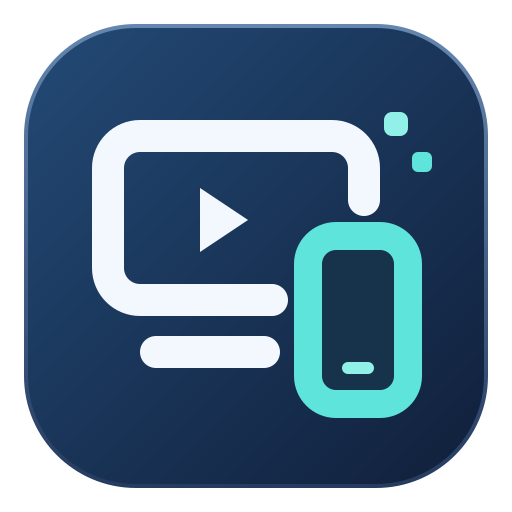

# OmniCast · Android screen mirroring and control

Mirror, control, and record Android devices over USB or local Wi-Fi on Windows, macOS, and Linux. OmniCast Desktop includes ADB and [scrcpy 5.0.1](https://github.com/Genymobile/scrcpy/releases/tag/v5.0.1). OmniCast Mobile lets an Android phone act as a separate USB OTG or wireless controller for another phone.

## Download

| Platform | Package |
| --- | --- |
| Windows x64 | [OmniCast for Windows](https://github.com/sabbirimon/OmniCast/releases/download/v2.1.1/OmniCast-Windows-x64.zip) |
| Intel macOS | [OmniCast for macOS](https://github.com/sabbirimon/OmniCast/releases/download/v2.1.1/OmniCast-macOS-Intel.zip) |
| Linux x64 | [OmniCast for Linux](https://github.com/sabbirimon/OmniCast/releases/download/v2.1.1/OmniCast-Linux-x64.tar.gz) |
| Android 8+ ARM | [OmniCast Mobile preview APK](https://github.com/sabbirimon/OmniCast/releases/download/v2.1.1/OmniCast-Mobile-debug.apk) |

Extract the whole desktop archive. The macOS build is locally signed and the APK is debug signed. [Checksums](https://github.com/sabbirimon/OmniCast/releases/download/v2.1.1/SHA256SUMS.txt)

## Get connected

1. On the phone, open **Settings → About phone** and tap **Build number** seven times. On Samsung, find it under **Software information**. Enter the PIN if asked.
2. Open **Settings → System → Developer options**. Enable **USB debugging**, attach a data cable, and approve the debugging prompt on the phone. On Android 11+, you can instead choose **Wireless debugging → Pair device with pairing code**.
3. Select a device and connection in OmniCast. Click **Mirror & Control** for mouse and keyboard control, or **View only** to watch. Use **Wireless manager** to discover nearby phones, enter an IP and pairing code, or pair by QR.

The desktop works offline over USB. Wireless mirroring uses the local network and does not need internet access. Android must authorize each controller. Saving a device name does not grant debugging access. On Windows, a phone may require its OEM USB driver. On Linux, USB detection may require Android udev rules.

## Devices and sessions

- Save a name and optionally open a muted mirror on USB reconnect. Saved devices remain visible when disconnected. Device names, timestamps, and up to 100 connection events stay in the app's local data folder.
- Open multiple mirrors, including USB and Wi‑Fi sessions for the same phone when it supports concurrent encoders. Each session has its own capture source and transfer rate. The **Active sessions** list lets you switch between and stop individual mirrors while others continue. The rate is the screen, audio, and input traffic through OmniCast, excluding USB or Wi‑Fi protocol overhead.
- Screen mirrors can retry up to three times after an unexpected drop. If enabled, USB can fall back to an already authorized Wi‑Fi connection. Camera, microphone, and recording sessions require a fresh start after a drop.
- Open Android's Quick Settings, notifications, Cast, Location, Accessibility, Developer options, or About phone directly. Use Android's Quick Settings to change Wi‑Fi, Bluetooth, and mobile data. Switching off Wi‑Fi breaks a Wi‑Fi mirror.
- The device panel can read the model, display size, battery, Android version, security patch, current Wi‑Fi MAC, and link rate where exposed. Wi‑Fi MAC may be randomized. Open **About phone** to see IMEI on devices that show it there.
- OmniCast loads exact product images for catalog matches and stores a local thumbnail for offline use. To add or replace a photo, open **Device information → Choose a device photo**. [Model coverage and logo sources](docs/DEVICE-CATALOG.md)

## ADB and recovery tools

Open **ADB tools** for the selected USB or Wi-Fi transport. **Open shell** starts an interactive Android terminal. Recovery actions can wake the screen, go Home, read device diagnostics, inspect common folders, export a screenshot, and show recent logs. Search the command guide, or view the installed ADB version’s full help.

If the display or touch is broken, an already authorized connection can still mirror and run these commands. **USB input without debugging** can simulate a physical keyboard and mouse with supported hardware. Use an external display if you need to see the phone before authorizing debugging.

## Display, gaming, and input

Settings covers keep awake, screen-off mirroring, hardware or software decoding, clipboard, fullscreen, quality, physical keyboard and mouse, and gamepads. **Keep Android display awake** applies to controllable screen mirrors over USB and Wi-Fi. In **Advanced capture**, create a fixed or flex virtual display and optionally launch an Android package on it. On Linux, a configured V4L2 loopback device can receive the captured video.

[Gaming controls plan](docs/GAMING.md) · [scrcpy codebase and architecture](docs/SCRCPY.md)

## Recording

Choose the phone screen or camera, a resolution, and a sound source. **Record video** writes MP4. **Record audio** writes M4A. Audio and microphone forwarding require Android 11 or later, and camera mirroring requires Android 12 or later. Android may reject capture or blank protected content.

The **Media + mic** recording option needs FFmpeg on the desktop's PATH. You can also set the FFMPEG environment variable before starting OmniCast. OmniCast captures two tracks from the target and combines them when recording ends. Device policies may prevent concurrent capture. If the mix fails, the original tracks are retained in the temporary recording folder shown in the error.

The microphone source is the **target phone's microphone**. OmniCast shows its own active mic or camera capture. Android's privacy indicators continue to show access by other apps.

## Build from source

    npm ci
    npm start
    npm run package
    bash scripts/build-android.sh

For desktop development, install Node.js 22.12 or newer and local ADB and scrcpy. The packaging script downloads checksum-verified upstream engines and produces Intel macOS, Windows x64, and Linux x64 archives. Use git submodule update --init to inspect the pinned scrcpy source. The packaging host needs curl, unzip, tar, zip, and Go for the Windows helper. macOS packaging uses Apple's codesign and ditto.

The APK build needs JDK 17 or 21, Android SDK 36, NDK 28.2.13676358, and the SDK's CMake. See [mobile attribution](android/UPSTREAM.md) for the upstream project and native pairing dependency.

See [the project plan](docs/PLAN.md) and [validation status](docs/STATUS.md) for the release scope and checks.
